# web.walls

**Animated live wallpapers for Windows 10/11.** Black holes, neon jellyfish, prairie fireflies, synthwave highways, rainy cities, northern lights and crusader battles, all running behind your desktop icons.

Built for OLED. Sharp on everything from a laptop to **8K**, smooth up to **240 Hz**, and it fits **every screen shape**: 16:9, 21:9 ultrawide, 32:9 super-ultrawide, even a laptop stood up in portrait.

### [⬇ Download the latest installer](https://github.com/MatsuYoda-88/webwalls/releases/latest)

Grab **WebWalls-Setup-x.y.z.exe** under *Assets*, run it, done. No admin needed.

> **"Windows protected your PC"?** Click **More info → Run anyway**. It's a free hobby app and isn't paid-signed; that's the only reason you see it.

**On Android?** Grab **WebWalls-Android-x.y.apk** from the newest *web.walls for Android* release on the [Releases page](https://github.com/MatsuYoda-88/webwalls/releases).

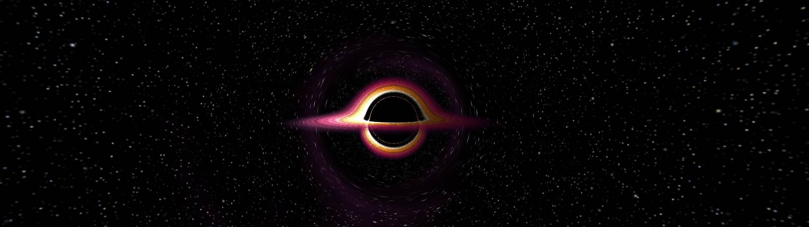

---

## The wallpapers

12 built in. **New in v0.8:** four OLED showcase scenes. They're drawn live by your graphics card at your screen's exact resolution (up to 8K), so they're razor sharp, and empty space is true black, so OLED pixels switch fully off.

| | |
|---|---|
| **Event Horizon** (new)<br>A real ray-traced black hole. Its gravity bends the glowing disk over the top and under the shadow, and warps the stars behind it. | **Abyss** (new)<br>Neon jellyfish swimming in pulses through the deep sea, wandering and tilting as they go, trailing glowing tentacles through plankton. |
|  | 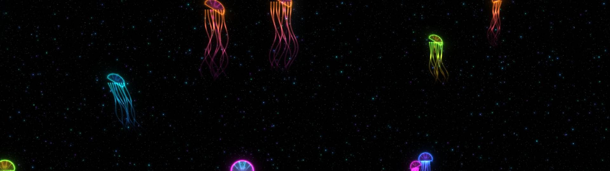 |
| **Prairie Fireflies** (new)<br>Thousands of fireflies blinking over dark grass under the Milky Way. | **Fractal Dive** (new)<br>Endless dives into the Mandelbrot set, drawn as razor-thin neon lines. Gets more detailed the higher your resolution. |
| 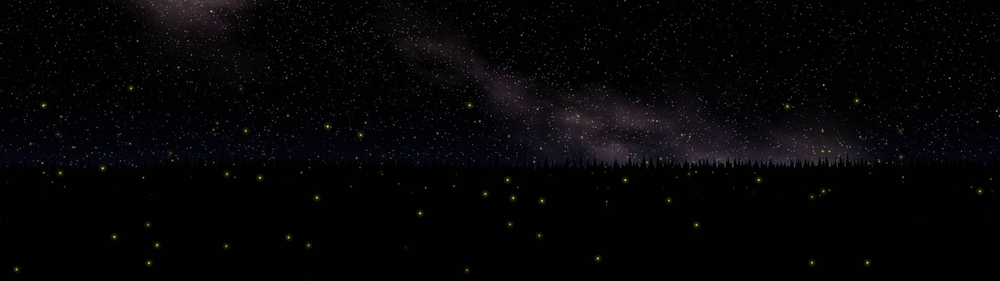 | 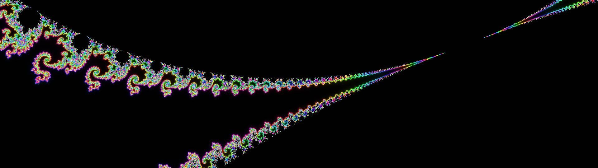 |
| **Neon Galaxy**<br>A spinning spiral galaxy with saturated nebulae, tuned for OLED. | **Neon Highway**<br>Synthwave road into a neon sunset. |
| 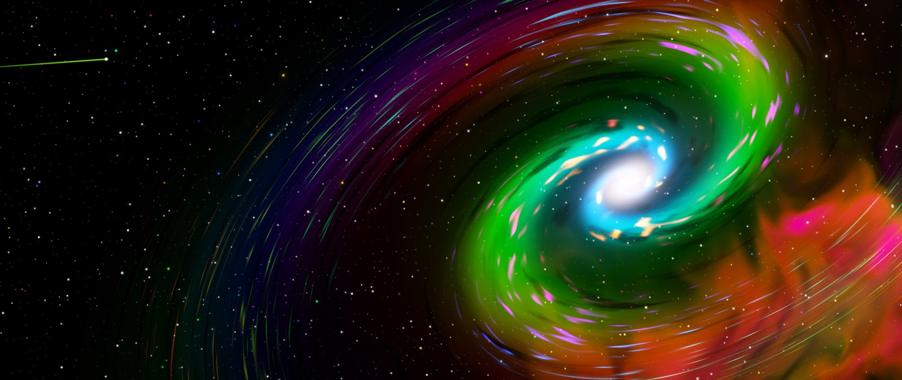 | 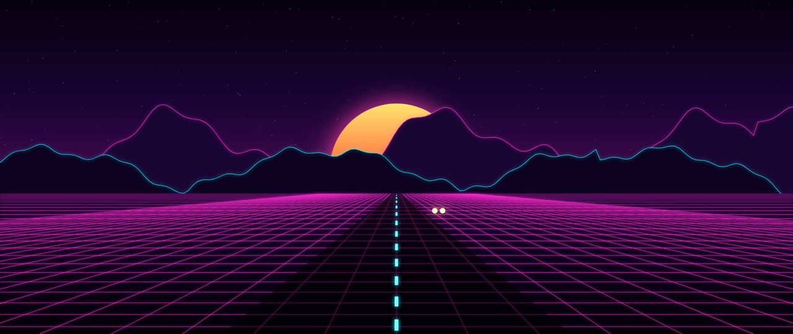 |
| **Midnight Rain City**<br>Rainy skyline with wet reflections. | **Aurora Lake**<br>Northern lights over a still lake. |
| 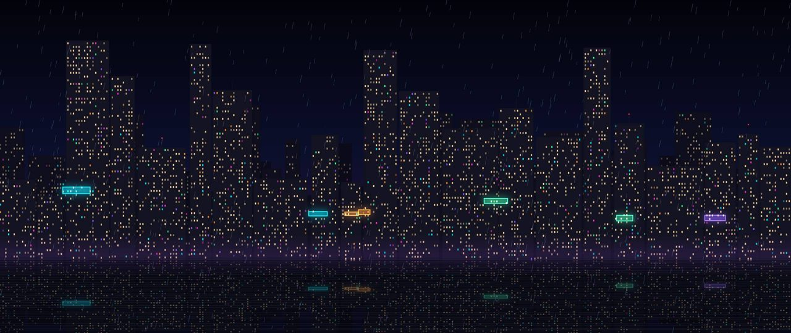 | 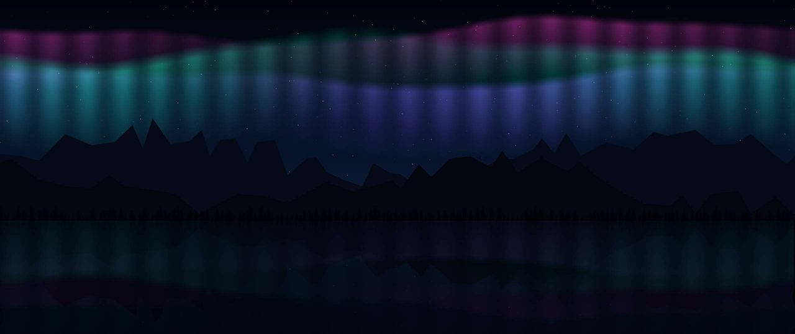 |
| **Baldwin's Crusade**<br>King Baldwin IV's host marching at sunset. | **The Montgisard trilogy**<br>The Battle, The Charge, and Jerusalem Holds. |
| 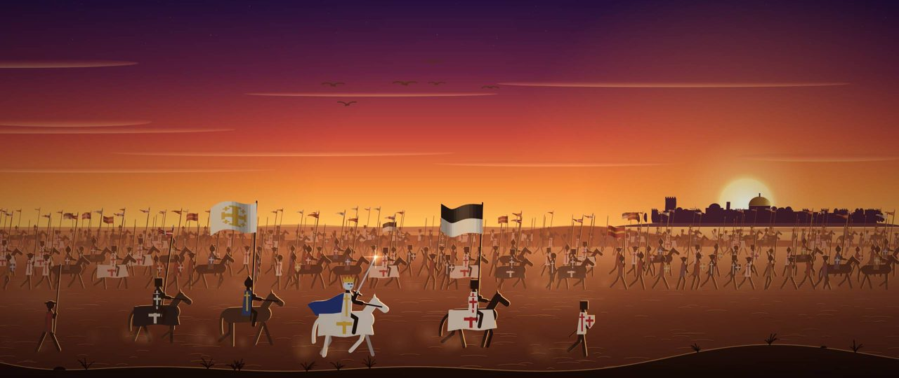 | 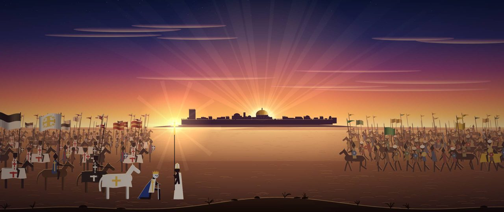 |

**Want more?** Load any HTML wallpaper you like, or make your own. 👉 **[How to add your own wallpapers](docs/ADD-WALLPAPERS.md)**

---

## Using it

Look for the neon **W** in the system tray (click the `^` by the clock if it's hidden).

- **Right-click the W**: pick a wallpaper, pause, change performance settings, turn screens on/off, start with Windows, quit.
- **Double-click the W**: pause / resume.
- **Quit** puts your normal Windows wallpaper back.

## Every screen, every shape

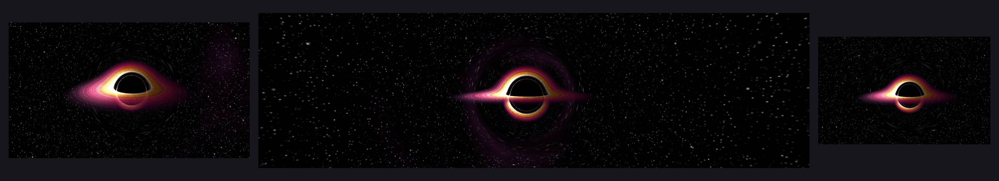

- **Each monitor gets its own copy** sized to *its* shape, so scenes fit instead of stretching across the gap. Above: a 4K TV, a 5120×1440 super-ultrawide and a laptop.
- **Any shape:** 16:9 and 16:10, 21:9 ultrawide, **32:9 super-ultrawide** (5120×1440, 3840×1080), and **portrait** 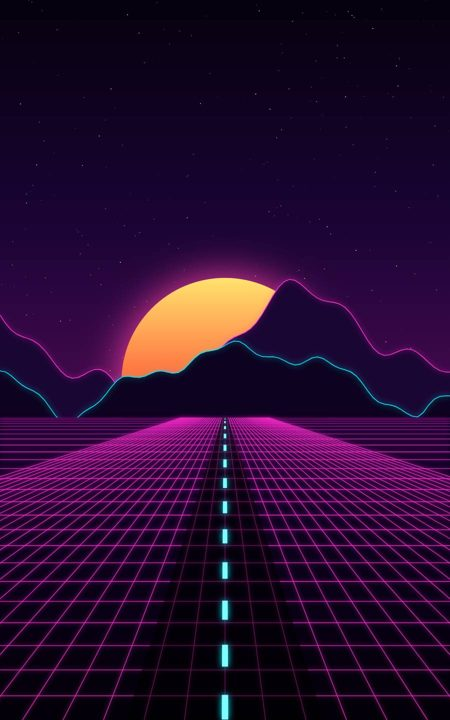
- **Any resolution up to 8K**, drawn at your screen's real pixels, not stretched.
- **Displays menu:** turn the wallpaper off on any monitor you want.
- **Plug in, unplug or rotate a screen** and web.walls rebuilds itself to match.

## Smooth, and out of your way

- **High refresh:** *Performance → Frame rate*: Unlimited (matches your screen), 240, 144, 120, 60, 30, 15. The new scenes move by real time, so they're just as smooth at 240 Hz as at 60. The default is 60 to keep things cool and quiet; crank it if you've got the screen for it.
- **Quality:** *Performance → Quality*: Full / Balanced (75%) / Performance (half resolution).
- **If your graphics card can't keep up**, the GPU scenes quietly drop a little resolution instead of stuttering.

### Gaming
- **The screen your game is on goes to sleep completely**, so the wallpaper never fights your game for the graphics card. It shows a still picture of its last frame instead of black.
- **Your other screens go lighter while you play** (30 FPS, half resolution). Change it in *Performance → Gaming*: Lighter / Freeze / Full quality.
- **Windowed and maximized games count too.** It knows games from Steam, Epic, GOG, Xbox, EA, Ubisoft, Riot, Battle.net and Rockstar, plus anything Windows Game Bar calls a game. A maximized Chrome or Discord is never mistaken for one.
- **Game not recognized?** Play it for a few seconds, then *Performance → Gaming → Treat "game.exe" as a game*. Or flip *Gaming mode on right now* by hand.

### Battery
- *Performance → On battery*: keep going full send, cap at 30 FPS (default), or pause.

### Fixes itself (v0.8)
- **Stays on.** Windows sometimes rebuilds the desktop (theme or wallpaper changes, sleep and wake, unlocking, screens turning on). web.walls notices and puts itself right back instead of leaving you staring at the stock Windows wallpaper.
- **Never stays frozen.** If a wallpaper crashes or loses the graphics card (driver reset, eGPU hiccup), it reloads itself.
- **Show fix log** in the tray menu lists everything it fixed on its own, with times.

### Sound
- Wallpapers are muted by default. Untick *Performance → Mute wallpaper sound* to hear them.

---

## Make your own wallpapers

Every wallpaper is just a web page. If it runs in Chrome, it runs on your desktop.

👉 **[Full tutorial: load, add and make your own wallpapers](docs/ADD-WALLPAPERS.md)**: covers loading files friends send you, adding them to the built-in list, a starter wallpaper to copy, and a ready-to-paste prompt to have an AI make one for you.

---

## What's new

- **v0.8.5**: jellyfish tentacles stay attached when they tilt.
- **v0.8.4**: Abyss jellies swim, wander and glow in neon; GPU scenes stay crisp no matter how long the PC's been on.
- **v0.8.3**: Start with Windows works again after updates, and stays on.
- **v0.8.2**: smoother; fixed lag from 0.8.1's self-healing checks. New *Show fix log* tray item.
- **v0.8.1**: self-healing: stays glued behind your icons and reloads crashed wallpapers on its own.
- **v0.8.0**: four OLED showcase scenes (Event Horizon, Abyss, Prairie Fireflies, Fractal Dive), up to 8K and 240 Hz.
- **v0.7**: 32:9 super-ultrawide support; 240 / 144 / 120 FPS options.
- **v0.6**: Neon Galaxy.
- **v0.4**: still picture instead of black on sleeping screens; better fullscreen detection.
- **v0.3**: gaming mode.
- **v0.2**: multi-monitor, ultrawide and portrait.

Full notes on the [Releases page](https://github.com/MatsuYoda-88/webwalls/releases).

---

## For tinkerers

<details>
<summary>Build it yourself, how releases work, where files live</summary>

### Build
Needs the .NET 8 SDK and Inno Setup 6:
```
dotnet publish src\WebWalls.csproj -c Release -r win-x64 --self-contained true -p:PublishSingleFile=true -p:IncludeNativeLibrariesForSelfExtract=true -p:EnableCompressionInSingleFile=true -o dist
ISCC /DAppVersion=0.8.2 installer\WebWalls.iss
```

### Releases
Bump `<Version>` in `src\WebWalls.csproj` and push to `main`. GitHub Actions builds the app and installer and publishes the Release automatically, using `RELEASE_NOTES.md` as the notes.

### Files
- `src\`: the app (C#, WinForms + WebView2)
- `wallpapers\`: built-in gallery (baked into the exe)
- `tools\gen_oled.py`: source for the four OLED scenes (each is one GPU shader); run it to regenerate them
- `examples\starter-wallpaper.html`: the starter from the tutorial
- `installer\`: Inno Setup script
- `.github\workflows\`: builds the Windows installer and the Android APK releases

### On your PC
- Settings: `%APPDATA%\WebWalls\settings.json`
- Gallery: `%APPDATA%\WebWalls\wallpapers`
- Fix log: `%APPDATA%\WebWalls\events.log` · crash log: `%APPDATA%\WebWalls\error.log`

Needs Windows 10/11 with the Edge WebView2 Runtime (already built into Windows 11).
</details>
